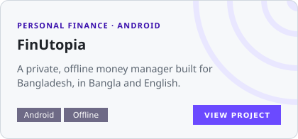
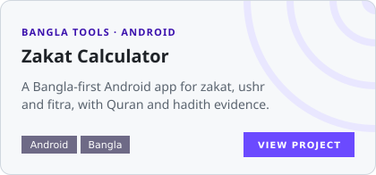
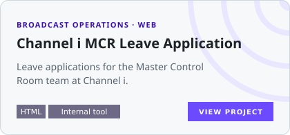
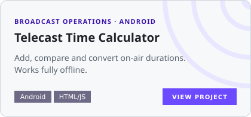
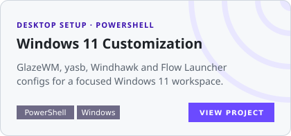
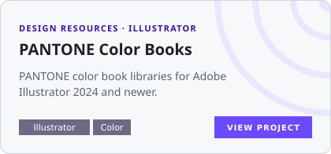
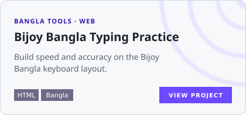
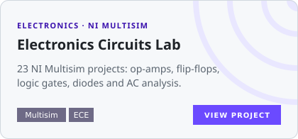

<picture>
  <source media="(prefers-color-scheme: dark)" srcset="https://readme-typing-svg.demolab.com?font=Sora&weight=600&size=22&pause=1400&color=B4ADFF&center=true&vCenter=true&width=640&lines=Broadcast+Operations+Engineer+%40+Channel+i;Brand+Identity+Designer+%C2%B7+8+years;IT+%C2%B7+Networks+%C2%B7+Systems;Engineering+the+signal.+Designing+the+brand." />
  <source media="(prefers-color-scheme: light)" srcset="https://readme-typing-svg.demolab.com?font=Sora&weight=600&size=22&pause=1400&color=3A10AD&center=true&vCenter=true&width=640&lines=Broadcast+Operations+Engineer+%40+Channel+i;Brand+Identity+Designer+%C2%B7+8+years;IT+%C2%B7+Networks+%C2%B7+Systems;Engineering+the+signal.+Designing+the+brand." />
  
</picture>

 

## About

I'm Abdullah Al Fahim, a Broadcast Operations Engineer from Dhaka. I keep Channel i on air, look after the systems behind it, and design brand identities. I also build small tools that make broadcast work and everyday life in Bangladesh a little easier.

<table>
  <tr>
    <th width="33%" align="left">Broadcast Engineering</th>
    <th width="33%" align="left">IT &amp; Systems</th>
    <th width="33%" align="left">Brand Design</th>
  </tr>
  <tr>
    <td valign="top">Transmission, encoding and live contribution for a national satellite TV network.</td>
    <td valign="top">System administration, networks, IT support and security practices.</td>
    <td valign="top">Brand guidelines, logos and visual identity systems since 2018, <!--years-->8<!--/years--> years and counting.</td>
  </tr>
</table>

## Experience

| Role | Where | Focus |
| :--- | :--- | :--- |
| **Broadcast Engineer, Transmission** |  | Bangladesh's first digital satellite television network |
| **Brand Identity Designer** | <a href="https://behance.net/hire-fahim"><picture><source media="(prefers-color-scheme: dark)" srcset="assets/logos/utopia-design-studio-dark.png" /></picture></a> | Brand guidelines, brand assets and identity design since 2018 (<!--years-->8<!--/years--> years) |
| **BSc, Electronics &amp; Communication Engineering** | ISTT, National University of Bangladesh | Electronics, communication systems and signal processing |

I also write technical documentation, run training sessions, and plan events across teams.

## Toolbox

<table>
  <tr>
    <td width="150"><b>Design &amp; media</b></td>
    <td></td>
  </tr>
  <tr>
    <td><b>Web &amp; docs</b></td>
    <td></td>
  </tr>
  <tr>
    <td><b>Dev tools</b></td>
    <td></td>
  </tr>
  <tr>
    <td><b>Systems</b></td>
    <td></td>
  </tr>
  <tr>
    <td><b>Broadcast</b></td>
    <td>
      
      
      
      
      
      
      
      
    </td>
  </tr>
</table>

## Featured projects

  <a href="https://github.com/abdullah-al-faahim/finutopia-releases"><picture><source media="(prefers-color-scheme: dark)" srcset="assets/cards/finutopia-dark.svg" /></picture></a>
  <a href="https://github.com/abdullah-al-faahim/zakat-calculator-app"><picture><source media="(prefers-color-scheme: dark)" srcset="assets/cards/zakat-calculator-app-dark.svg" /></picture></a>
  <a href="https://github.com/abdullah-al-faahim/Channel-i-MCR-Leave-Application"><picture><source media="(prefers-color-scheme: dark)" srcset="assets/cards/channel-i-mcr-leave-dark.svg" /></picture></a>
  <a href="https://github.com/abdullah-al-faahim/Telecast-Time-Calculator"><picture><source media="(prefers-color-scheme: dark)" srcset="assets/cards/telecast-time-calculator-dark.svg" /></picture></a>
  <a href="https://github.com/abdullah-al-faahim/Windows-11-Customization"><picture><source media="(prefers-color-scheme: dark)" srcset="assets/cards/windows-11-customization-dark.svg" /></picture></a>
  <a href="https://github.com/abdullah-al-faahim/PANTONE-colorbooks"><picture><source media="(prefers-color-scheme: dark)" srcset="assets/cards/pantone-colorbooks-dark.svg" /></picture></a>
  <a href="https://github.com/abdullah-al-faahim/Bijoy-Bangla-Typing-Practice"><picture><source media="(prefers-color-scheme: dark)" srcset="assets/cards/bijoy-typing-practice-dark.svg" /></picture></a>
  <a href="https://github.com/abdullah-al-faahim/electronics-circuit"><picture><source media="(prefers-color-scheme: dark)" srcset="assets/cards/electronics-circuit-dark.svg" /></picture></a>

  

<picture>
  <source media="(prefers-color-scheme: dark)" srcset="https://raw.githubusercontent.com/abdullah-al-faahim/abdullah-al-faahim/output/github-snake-dark.svg" />
  <source media="(prefers-color-scheme: light)" srcset="https://raw.githubusercontent.com/abdullah-al-faahim/abdullah-al-faahim/output/github-snake.svg" />
  
</picture>

---

**Engineering the signal. Designing the brand. Solving problems.**

[LinkedIn](https://linkedin.com/in/abdullah-al-fahim) · [Behance](https://behance.net/hire-fahim) · [Email](mailto:alfahim604@yahoo.com)

