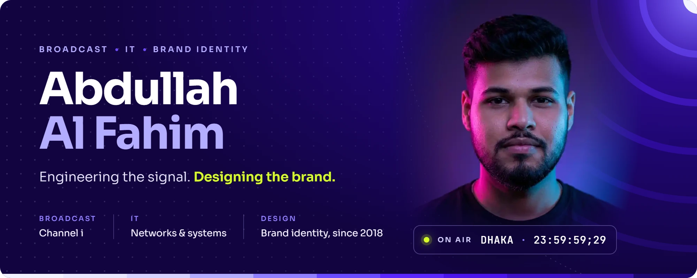

<picture>
  <source media="(prefers-color-scheme: dark)" srcset="https://readme-typing-svg.demolab.com?font=Sora&weight=600&size=22&pause=1400&color=B4ADFF&center=true&vCenter=true&width=640&lines=Broadcast+Operations+Engineer+%40+Channel+i;Brand+Identity+Designer+%C2%B7+8+years;IT+%C2%B7+Networks+%C2%B7+Systems;Engineering+the+signal.+Designing+the+brand." />
  <source media="(prefers-color-scheme: light)" srcset="https://readme-typing-svg.demolab.com?font=Sora&weight=600&size=22&pause=1400&color=3A10AD&center=true&vCenter=true&width=640&lines=Broadcast+Operations+Engineer+%40+Channel+i;Brand+Identity+Designer+%C2%B7+8+years;IT+%C2%B7+Networks+%C2%B7+Systems;Engineering+the+signal.+Designing+the+brand." />
  
</picture>
 

 

&nbsp;
&nbsp;
&nbsp;
&nbsp;
&nbsp;
&nbsp;

<h2><picture><source media="(prefers-color-scheme: dark)" srcset="assets/headings/about-dark.svg" />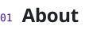</picture></h2>

I'm Abdullah Al Fahim, a Broadcast Operations Engineer from Dhaka. I keep Channel i on air, look after the systems behind it, and design brand identities. I also build small tools that make broadcast work and everyday life in Bangladesh a little easier.

<table>
  <tr>
    <th width="33%" align="left">Broadcast Engineering</th>
    <th width="33%" align="left">IT &amp; Systems</th>
    <th width="33%" align="left">Brand Design</th>
  </tr>
  <tr>
    <td valign="top">Transmission, encoding and live contribution for a national satellite TV network.</td>
    <td valign="top">System administration, networks, IT support and security practices.</td>
    <td valign="top">Brand guidelines, logos and visual identity systems since 2018, <!--years-->8<!--/years--> years and counting.</td>
  </tr>
</table>

<h2><picture><source media="(prefers-color-scheme: dark)" srcset="assets/headings/experience-dark.svg" />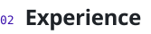</picture></h2>

| Role | Where | Focus |
| :--- | :--- | :--- |
| **Broadcast Engineer, Transmission** |  | Bangladesh's first digital satellite television network |
| **Founder &amp; Creative Director** | <a href="https://behance.net/hire-fahim"><picture><source media="(prefers-color-scheme: dark)" srcset="Utopia%20SoftTech%20(white).png" /></picture></a> | Design and software studio: brand identity, apps and tools for Bangladesh, since 2018 (<!--years-->8<!--/years--> years) |
| **BSc, Electronics &amp; Communication Engineering** | <a href="https://istt.edu.bd"><picture><source media="(prefers-color-scheme: dark)" srcset="assets/logos/nu-istt-dark.png" /></picture></a> | Electronics, communication systems and signal processing |

<picture>
  <source media="(max-width: 600px)" srcset="assets/callouts/also-narrow.svg" />
  <source media="(max-width: 1279px)" srcset="assets/callouts/also-medium.svg" />
  <source media="(prefers-color-scheme: dark)" srcset="assets/callouts/also-dark-wide.svg" />
  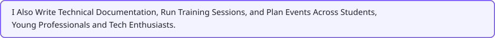
</picture>

<h2><picture><source media="(prefers-color-scheme: dark)" srcset="assets/headings/toolbox-dark.svg" /></picture></h2>

<table>
  <tr>
    <td width="150"><b>Design &amp; media</b></td>
    <td></td>
  </tr>
  <tr>
    <td><b>Web &amp; docs</b></td>
    <td></td>
  </tr>
  <tr>
    <td><b>Dev tools</b></td>
    <td></td>
  </tr>
  <tr>
    <td><b>Systems</b></td>
    <td></td>
  </tr>
  <tr>
    <td><b>Broadcast</b></td>
    <td>
      
      
      
      
      
      
      
      
    </td>
  </tr>
</table>

<h2><picture><source media="(prefers-color-scheme: dark)" srcset="assets/headings/featured-projects-dark.svg" /></picture></h2>

  <a href="https://github.com/abdullah-al-faahim/taka-releases"><picture><source media="(prefers-color-scheme: dark)" srcset="assets/cards/taka-dark.svg" />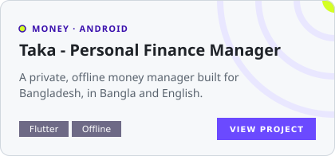</picture></a>
  <a href="https://github.com/abdullah-al-faahim/telecast-time-calculator-app"><picture><source media="(prefers-color-scheme: dark)" srcset="assets/cards/telecast-time-calculator-app-dark.svg" />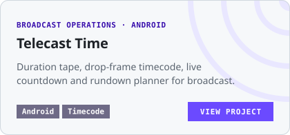</picture></a>
  <a href="https://github.com/abdullah-al-faahim/Roktobondhu-releases"><picture><source media="(prefers-color-scheme: dark)" srcset="assets/cards/roktobondhu-dark.svg" />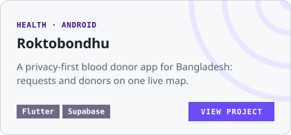</picture></a>
  <a href="https://github.com/abdullah-al-faahim/khanfarhana.info-case-study"><picture><source media="(prefers-color-scheme: dark)" srcset="assets/cards/khanfarhana-info-dark.svg" />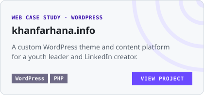</picture></a>
  <a href="https://github.com/abdullah-al-faahim/zakat-calculator-app"><picture><source media="(prefers-color-scheme: dark)" srcset="assets/cards/zakat-calculator-app-dark.svg" />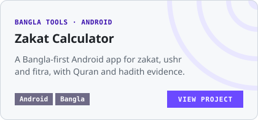</picture></a>
  <a href="https://github.com/abdullah-al-faahim/PANTONE-colorbooks"><picture><source media="(prefers-color-scheme: dark)" srcset="assets/cards/pantone-colorbooks-dark.svg" />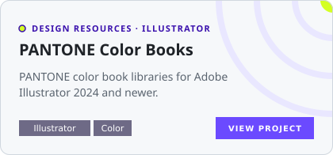</picture></a>
  <a href="https://github.com/abdullah-al-faahim/photocard-studio"><picture><source media="(prefers-color-scheme: dark)" srcset="assets/cards/photocard-studio-dark.svg" />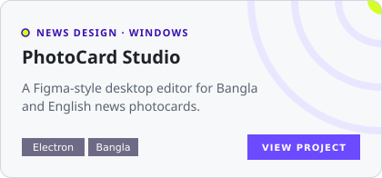</picture></a>
  <a href="https://github.com/abdullah-al-faahim/electronics-circuit"><picture><source media="(prefers-color-scheme: dark)" srcset="assets/cards/electronics-circuit-dark.svg" />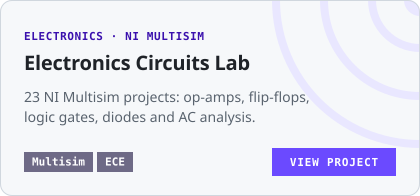</picture></a>
  <a href="https://github.com/abdullah-al-faahim/TaskBell-releases"><picture><source media="(prefers-color-scheme: dark)" srcset="assets/cards/taskbell-dark.svg" />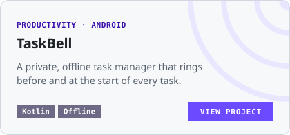</picture></a>
  <a href="https://github.com/abdullah-al-faahim/Windows-11-Customization"><picture><source media="(prefers-color-scheme: dark)" srcset="assets/cards/windows-11-customization-dark.svg" />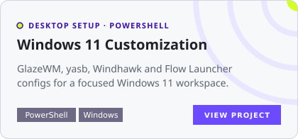</picture></a>

  

<h2><picture><source media="(prefers-color-scheme: dark)" srcset="assets/headings/achievements-dark.svg" /></picture></h2>

  <a href="https://github.com/abdullah-al-faahim/github-achievements/blob/main/achievements/starstruck.md"><picture><source media="(prefers-color-scheme: dark)" srcset="assets/achievements/starstruck-dark.svg" />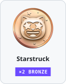</picture></a>
  <a href="https://github.com/abdullah-al-faahim/github-achievements/blob/main/achievements/pull-shark.md"><picture><source media="(prefers-color-scheme: dark)" srcset="assets/achievements/pull-shark-dark.svg" />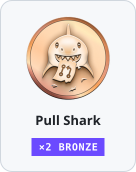</picture></a>
  <a href="https://github.com/abdullah-al-faahim/github-achievements/blob/main/achievements/pair-extraordinaire.md"><picture><source media="(prefers-color-scheme: dark)" srcset="assets/achievements/pair-extraordinaire-dark.svg" />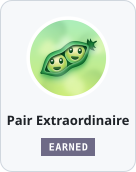</picture></a>
  <a href="https://github.com/abdullah-al-faahim/github-achievements/blob/main/achievements/yolo.md"><picture><source media="(prefers-color-scheme: dark)" srcset="assets/achievements/yolo-dark.svg" />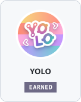</picture></a>

<picture>
  <source media="(prefers-color-scheme: dark)" srcset="https://raw.githubusercontent.com/abdullah-al-faahim/abdullah-al-faahim/output/github-snake-dark.svg" />
  <source media="(prefers-color-scheme: light)" srcset="https://raw.githubusercontent.com/abdullah-al-faahim/abdullah-al-faahim/output/github-snake.svg" />
  
</picture>

---

**Engineering the signal. Designing the brand. Solving problems.**

